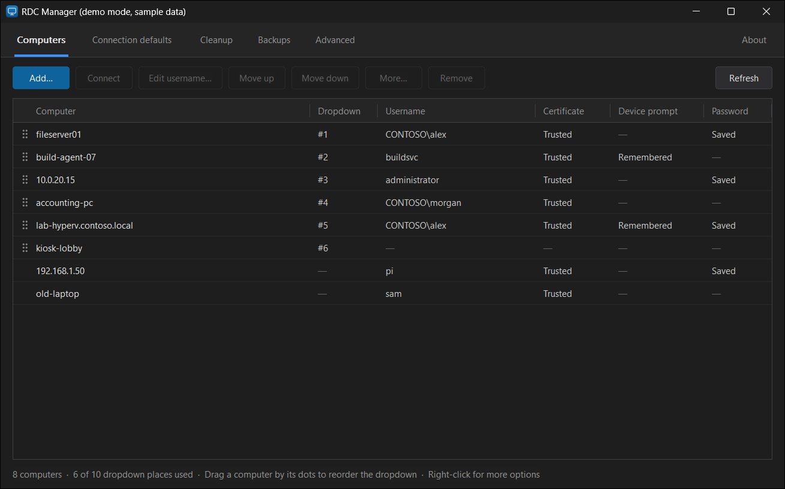

# RDC Manager

A small Windows app for managing everything Remote Desktop Connection (`mstsc.exe`) remembers about the computers you connect to.

Windows gives you no way to edit the dropdown list in Remote Desktop Connection, short of editing the registry by hand. RDC Manager does that, and covers the other places Remote Desktop keeps history too.



- One file, about 150 KB. Nothing to install and no runtime to download.
- Written in plain C against the Windows API. No frameworks.
- Dark mode only.
- Every change is backed up first and can be restored from inside the app.

## Download

Get `RDCManager.exe` from the [latest release](https://github.com/bommerts/RDC-Manager/releases/latest) and run it. It works on Windows 10 (version 1903 or later) and Windows 11, and does not need administrator rights.

The exe is not code-signed, so Windows SmartScreen may show a warning the first time. Choose **More info**, then **Run anyway**. Each release lists the file's SHA-256 so you can check your download.

## What it manages

| Page | What you can do | Where Windows keeps it |
|---|---|---|
| **Computers** | Remove, reorder or add entries in the dropdown list. Change or forget the username filled in for a computer. Forget a certificate you trusted, a remembered device prompt answer, or a saved password. | `HKCU\Software\Microsoft\Terminal Server Client` (`Default`, `Servers`, `LocalDevices`) and Windows Credential Manager (`TERMSRV/<computer>`) |
| **Connection defaults** | View and edit the settings Remote Desktop Connection starts with (display, sound, shared devices and so on), with a plain description of each one. | `Default.rdp` in your Documents folder |
| **Cleanup** | Clear history in bulk, including the screen cache and the taskbar jump list. | The locations above, plus `%LOCALAPPDATA%\Microsoft\Terminal Server Client\Cache` and the jump list file |
| **Backups** | Restore an earlier state, or make a backup yourself. | `%LOCALAPPDATA%\RDC Manager\Backups` |
| **Advanced** | Read-only view of other Remote Desktop client settings, including Group Policy. | Other values under the keys above, and `HKLM` |

The Computers page shows one row per computer, combining all the places a computer can be remembered. Computers that are no longer in the dropdown but still have leftover data show up too.

### Reordering the dropdown

Each computer that is in the dropdown has a handle at the left of its row: two columns of dots. Drag a row by its handle to move it. A copy of the row follows the pointer and the other rows slide out of the way as you go. Drop it inside the list to save the new order. To cancel, press `Esc` or drop it outside the list.

You can also right-click a computer and choose **Move to top** or **Move to bottom**, or use the **Move up** and **Move down** buttons.

Computers that are not in the dropdown have no handle, because Remote Desktop keeps no order for them. Right-click one and choose **Add to dropdown** first.

## Backups and undo

Before every change to the registry or to `Default.rdp`, RDC Manager saves the current state to the backup folder. The **Backups** page lists them and restores any of them. The newest 100 automatic backups are kept.

Registry backups are ordinary `.reg` files, so you can read them in Notepad, or restore one without this app by double-clicking it.

Three things can't be backed up, and the app tells you before deleting them:

- **Saved passwords.** Windows does not allow programs to read them back out.
- **The screen cache** and **the taskbar jump list.** Windows rebuilds these by itself.

### Close Remote Desktop Connection first

Remote Desktop Connection keeps its own copy of the dropdown list while it is open, and writes it back when it connects. A change made while it is open can be undone that way. RDC Manager shows a warning when it sees Remote Desktop Connection running.

## Try it safely

```
RDCManager.exe --demo
```

Demo mode runs the whole app against made-up sample data. It does not read or change your real Remote Desktop history, and it removes the sample data when you close it.

## Keyboard

| Key | Action |
|---|---|
| `Ctrl+1` to `Ctrl+5` | Switch page |
| `F5` | Refresh |
| `Enter` or double-click | Connect (Computers), edit (Connection defaults), restore (Backups) |
| `Del` | Remove or delete the selection |
| `F2` | Edit username or setting |
| `Alt+Up`, `Alt+Down` | Move a computer up or down the dropdown |
| `Esc` | Cancel a drag |
| `Ctrl+C` | Copy the computer name |
| `Shift+F10` | Open the right-click menu |

## Build from source

You need Visual Studio 2022 or later with the "Desktop development with C++" workload, and CMake 3.20 or later.

```
cmake -S . -B build -A x64
cmake --build build --config Release
ctest --test-dir build -C Release
```

The exe is written to `build\Release\RDCManager.exe`.

### Layout

| Path | Contents |
|---|---|
| `src/model.c` | The per-computer data: dropdown list, usernames, certificates, device prompts, credentials |
| `src/regfile.c` | `.reg` export and import, and the backup folder |
| `src/rdpfile.c` | Reading and writing `Default.rdp` |
| `src/cleanup.c` | Screen cache, jump list, detecting `mstsc.exe` |
| `src/ui_dark.c` | The dark buttons, lists and dialogs |
| `src/ui_main.c` | The main window and its commands |
| `src/demo.c` | Demo mode |
| `tests/tests.c` | Tests for everything that isn't user interface |

The tests run against a throwaway registry key and a temp folder, never your real data.

## Design notes

**Why it is small.** The app uses only the Windows API. The compiler's small support library is linked in, and the larger C runtime is the copy that ships with Windows 10 and 11, so there is nothing to redistribute.

**How dark mode works.** Windows has no supported dark mode for its standard controls, so RDC Manager draws its own buttons, list rows, column headers and dialogs. Two things are still drawn by Windows: right-click menus and scroll bars. Those are switched to dark with two long-standing but undocumented Windows functions, the same ones Notepad++ uses. If a future Windows update removes them, the app keeps working and only those two elements fall back to the system colours.

**Safety.**

- The `.reg` importer only writes below the `Terminal Server Client` key and ignores everything else in a file. It checks the whole file before changing anything.
- Files are written to a temporary file and then swapped into place, so a failed write can't leave a half-written `Default.rdp`.
- DLLs are loaded from `System32` only, so a DLL placed next to the exe (for example in your Downloads folder) is never loaded.
- The build treats warnings as errors and passes Microsoft's static code analysis (`/analyze`) with no findings.

## Not affiliated with Microsoft

RDC Manager is an independent project. It is not the same thing as Microsoft's *Remote Desktop Connection Manager* (RDCMan), which is a tool for organising many connections. This app only manages what the built-in Remote Desktop Connection client remembers.

## License

[MIT](LICENSE)
